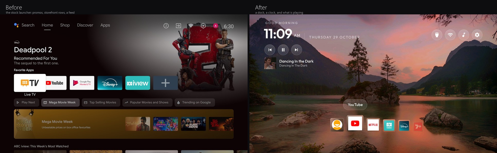
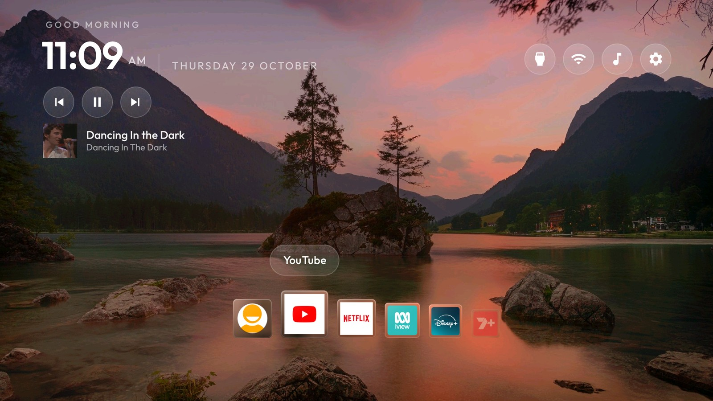
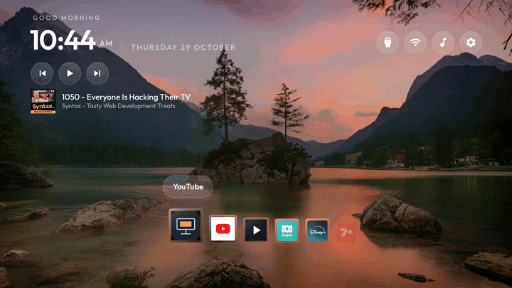

# Quay

### Your TV. Your apps. Nothing in the way.

**A beautifully minimal Android TV launcher that puts your content first. No ads, no recommendations, no clutter. Just a better way to use your TV.**



Modern smart TVs have a strange idea of what a home screen should be.

Sponsored movies. Trending shows. Recommendations you never asked for. Endless rows of content competing for your attention.

And somewhere in the middle of it all, the apps you actually want to use.

**Quay changes that.**

Inspired by the simplicity of Apple TV and the fluid animations of modern desktop interfaces, Quay replaces the traditional Android TV home screen with something cleaner, faster and a lot more enjoyable.

A floating dock. Beautiful glass effects. A bold clock. Your music. Your apps.

That's it.

---

## A home screen worth coming home to



Quay is designed around one simple idea: your TV should get out of the way and let you enjoy what you came to watch.

Everything has a purpose. Every animation feels intentional. Nothing is fighting for your attention.

### A dock that feels alive

Forget endless grids of tiny app icons.



Quay features a floating, animated dock inspired by the macOS Dock.

As you navigate, the selected app smoothly magnifies while neighbouring icons shift aside to make room.

The dock follows your selection, keeping your favourite apps within reach without filling the screen.

Under the hood, spring-based animations make navigation feel natural and responsive, even when holding down the remote.

**Small details. Big difference.**

### Glass, without the performance hit

Each dock icon floats on a translucent glass tile, complete with subtle refraction, highlights and depth.

The effect looks like something you'd expect from a modern, high-end interface.

But there's a clever trick behind it.

Instead of calculating expensive blur effects every frame, Quay processes the wallpaper once and uses a tiny precomputed texture to create the illusion of refracted glass.

The result?

Beautiful glass effects that work on older Android TV hardware, without needing a powerful GPU.

### Your music, right where it belongs

Quay includes a clean, integrated Now Playing display.

When you're listening to music, the home screen comes alive with:

* Album artwork
* Song title and artist
* Playback controls
* A subtle, uncluttered presentation beneath the clock

It works through Android's media session system, so it isn't tied to any particular music service.

Whether you're listening to Spotify or another compatible media app, your music feels like part of the interface.

### Less searching. More watching.

The top bar keeps essential controls just one click away.

Quickly access your HDMI inputs, check your Wi-Fi connection or open settings without navigating through Android's usual maze of menus.

Everything opens in a compact, frosted-glass panel that matches the rest of Quay.

Simple, accessible and always where you'd expect it.

A longer clip, including the inputs menu, is at [quay/media/quay-demo.mp4](quay/media/quay-demo.mp4).

---

## One dock. Multiple devices.

### Launch apps on your Fire TV Stick

Why use the TV's slower built-in apps when you already have a better streaming device plugged in?

Quay can bridge the gap.

Configure a dock tile for Netflix on your Fire TV Stick, and selecting it can:

1. Switch your television to the correct HDMI input.
2. Send a launch request to Netflix on the connected device.

No need to navigate between two separate home screens.

Quay uses the [DIAL protocol](http://www.dial-multiscreen.org/) to communicate with compatible streaming devices over your local network.

There's no need to leave ADB debugging enabled or manually reconnect after every update.

**Compatibility note:** DIAL support depends on the streaming device and individual app. Netflix is the primary supported example on Fire OS; not every app can be launched this way.

---

## Built for TVs that aren't brand new

You shouldn't need to buy a new television just to get a decent home screen.

Quay is designed to be lightweight, with compatibility and performance in mind.

The release APK is approximately **534 KB**, and the launcher avoids heavyweight frameworks and unnecessary background services.

The interface is built with native Android views, lightweight animations and carefully optimised visual effects.

### Compatibility

| Platform                     | Support                                                        |
| ---------------------------- | -------------------------------------------------------------- |
| Android TV 8.0+              | Supported target                                               |
| Android TV 9, 10, 11+        | Expected to work                                               |
| Google TV                    | Expected to work, with launcher-specific setup                 |
| MediaTek and other chipsets  | Hardware-specific input configuration may be required          |
| Android TV streaming boxes   | Launcher functionality available; HDMI switching may not apply |
| Amazon Fire TV               | Not supported as a replacement Home launcher                   |
| Some manufacturer-locked TVs | May restrict third-party launchers                             |

Quay has currently been tested on one television, so compatibility across other models hasn't been fully verified.

If you're trying it on new hardware, the dock's magnification effect can also be disabled while testing.

---

## Make Quay yours

Quay isn't designed around one specific television or collection of apps.

You can customise the dock, wallpaper, HDMI shortcuts, visual effects and more.

### Your apps, your order

Add your favourite apps to the dock and arrange them however you like.

You can mix installed Android applications with HDMI inputs and supported streaming-device shortcuts.

For example, your dock could contain:

**Fire TV · Netflix · YouTube · Spotify · HDMI 1 · Settings**

No imposed app categories. No sponsored positions. No algorithms deciding what belongs on your home screen.

### Custom wallpapers

Give Quay a completely different personality with your own wallpaper.

Choose something colourful, cinematic, abstract or beautifully minimal.

The glass dock and ambient colour effects help the interface blend naturally with your background.

### Fine-tune the experience

Want the dock animations to feel snappier?

Prefer larger icons or a more subtle glass effect?

Quay exposes several settings that let you adjust the interface to suit your preferences.

---

# Getting started

Quay is an Android TV launcher that you build and install using Android Debug Bridge (ADB).

You'll need a computer with ADB, a compatible Android TV device and developer debugging enabled.

### 1. Clone the repository

```bash
git clone https://github.com/checkmate-automate/Quay-DebloatedAndroidLauncher.git
cd Quay-DebloatedAndroidLauncher
```

### 2. Configure your TV

The main configuration file is located at:

```text
launcher/app/src/main/res/values/config.xml
```

This controls the apps shown in your dock, HDMI inputs and supported launcher options.

The included configuration is an example from the original development television, so you'll want to update it for your own setup.

**Find your installed TV apps:**

```bash
adb shell cmd package query-activities \
  -a android.intent.action.MAIN \
  -c android.intent.category.LEANBACK_LAUNCHER
```

**Find your HDMI input identifiers:**

```bash
adb shell dumpsys tv_input
```

HDMI identifiers differ between manufacturers and chipsets, so make sure you use the values reported by your device.

### 3. Customise your dock

Your dock configuration lives in `config.xml`.

Here's an example:

```xml
<string-array name="dock_apps">
    <item>com.google.android.youtube.tv</item>
    <item>input:YOUR_HDMI_INPUT=Fire TV</item>
    <item>input:YOUR_HDMI_INPUT=Netflix|dial:Netflix|icon:ic_app_tile</item>
</string-array>

<integer name="columns">9</integer>
```

Replace `YOUR_HDMI_INPUT` with the identifier returned by your television.

Each entry supports different behaviour:

| Configuration     | Purpose                                          |
| ----------------- | ------------------------------------------------ |
| `com.example.app` | Launch an installed Android application          |
| `input:<id>`      | Switch to an HDMI or TV input                    |
| `=<Label>`        | Give an input a custom display name              |
| `\|dial:<App>`    | Launch a compatible app on the connected device  |
| `\|icon:<name>`   | A bundled drawable, an installed app's package, or a file in the TV's `icons/` folder |

The `columns` setting controls dock capacity and influences icon sizing.

A tile that opens an app on another device has no local app to take an icon from. Rather than ship
other people's logos, Quay reads pictures you put in its own `icons/` folder:

```bash
adb shell mkdir -p /sdcard/Android/data/com.gathin.tvhome/files/icons
adb push netflix.png /sdcard/Android/data/com.gathin.tvhome/files/icons/netflix.png
```

Then name the file: `input:<id>=Netflix|dial:Netflix|icon:netflix.png`.

### 4. Build Quay

You'll need:

* JDK 17
* Android SDK Platform 34
* Android Build Tools 34.0.0

From the repository directory:

```bash
cd launcher
./gradlew --no-daemon lintRelease assembleRelease
```

Your APK will be generated at:

```text
launcher/app/build/outputs/apk/release/app-release.apk
```

### 5. Install it on your TV

Make sure your TV and computer are connected to the same network and ADB debugging is enabled.

Connect to the television:

```bash
adb connect <TV_IP_ADDRESS>:5555
```

Install Quay:

```bash
adb install -r app/build/outputs/apk/release/app-release.apk
```

Then set Quay as your preferred Home launcher.

First, identify your existing launcher:

```bash
adb shell cmd package resolve-activity --brief \
  -a android.intent.action.MAIN \
  -c android.intent.category.HOME
```

If your device permits third-party launchers, you can set Quay as Home:

```bash
adb shell cmd package set-home-activity --user 0 \
  com.gathin.tvhome/.MainActivity
```

Some televisions require the manufacturer's launcher to be disabled before the change takes effect.

For example, on a device using the standard Google Android TV launcher:

```bash
adb shell pm disable-user --user 0 com.google.android.tvlauncher
```

Only disable a launcher after confirming its package name and that Quay is installed and launchable.

You can optionally compile Quay ahead of time to improve startup performance:

```bash
adb shell cmd package compile -m speed -f com.gathin.tvhome
```

This optimisation may need to be repeated after installing an updated APK.

### 6. Add your wallpaper

Quay loads its wallpaper and runtime configuration from its external files directory.

From the repository root:

```bash
adb push quay/wallpaper.jpg \
  /sdcard/Android/data/com.gathin.tvhome/files/wallpaper.jpg

adb push quay/config.json \
  /sdcard/Android/data/com.gathin.tvhome/files/config.json
```

Restart the launcher to apply your changes:

```bash
adb shell am force-stop com.gathin.tvhome
```

### 7. Enable Now Playing

To let Quay display music and playback controls, enable its Android notification listener:

```bash
adb shell cmd notification allow_listener \
  com.gathin.tvhome/com.gathin.tvhome.MediaListener
```

This gives Quay access to compatible active media sessions.

---

## Personalise the details

Want to experiment with the interface?

These are some of the settings worth exploring.

| Setting           | Location            | What it changes                               |
| ----------------- | ------------------- | --------------------------------------------- |
| `DOCK_MAGNIFY`    | `AppAdapter.java`   | How much focused and neighbouring icons grow  |
| `DOCK_WINDOW`     | `AppAdapter.java`   | Number of icons shown around the selection    |
| `DOCK_EDGE_ALPHA` | `AppAdapter.java`   | Transparency of icons at the dock edges       |
| `DOCK_EDGE_SCALE` | `AppAdapter.java`   | Size of icons towards the edges               |
| `DOCK_STIFFNESS`  | `AppAdapter.java`   | Speed and responsiveness of spring animations |
| `DOCK_GAP_DP`     | `AppAdapter.java`   | Spacing between dock icons                    |
| `LENS`            | `GlassTile.java`    | Strength of the glass refraction effect       |
| `AMBIENT_ALPHA`   | `MainActivity.java` | Intensity of the ambient wallpaper colour     |
| `dock_magnify`    | `config.xml`        | Enable or disable dock magnification          |

Some settings are defined in Java and require rebuilding the APK after modification.

The goal is to make experimentation easy without needing to redesign the entire launcher.

---

## Going back to your original launcher

Quay doesn't require permanently removing your manufacturer's launcher.

If you've disabled the standard Google Android TV launcher, you can restore it with:

```bash
adb shell pm enable --user 0 com.google.android.tvlauncher

adb shell cmd package set-home-activity --user 0 \
  com.google.android.tvlauncher/.MainActivity
```

For other manufacturers, substitute the appropriate launcher package and Home activity.

Your original launcher can be restored without performing a factory reset, provided its system package hasn't been removed from the firmware.

---

## Under the hood

Quay takes a deliberately lightweight approach.

Rather than relying on a large UI framework, it uses native Android components to create an interface that feels modern without requiring modern hardware.

A few of the details that make it work:

**Spring-based navigation**

The dock uses responsive spring animations to create smooth, natural transitions between icons.

**Lightweight glass effects**

Precomputed wallpaper textures provide a convincing glass appearance without demanding real-time background blur.

**Native media integration**

Android media sessions provide playback information and controls without tying the interface to a particular streaming service.

**Flexible input handling**

HDMI switching uses Android's TV input system, allowing different televisions to supply their own hardware-specific input identifiers.

**DIAL integration**

Compatible streaming apps can be launched over the local network without requiring ADB access to the streaming device.

**Small footprint**

The interface prioritises minimal dependencies, efficient rendering and low resource consumption.

The result is a launcher designed to feel polished even on modest hardware.

---

## Built on open source

Quay builds on the excellent work of [Gathin23/cleanyourtv](https://github.com/Gathin23/cleanyourtv), an open-source project focused on improving the Android TV experience.

That project provides the original launcher foundation, ADB tooling and a substantial collection of tested debloating configurations.

Quay builds on that foundation with its own visual identity, animated dock, glass effects, media integration and streaming-device shortcuts.

If you're interested in debloating your television or exploring the original tools, check out the upstream documentation:

[Original README](README-upstream.md) · [中文](README.zh-CN.md) · [日本語](README.ja.md) · [Tiếng Việt](README.vi.md)

Developers and coding agents can also refer to [AGENTS.md](AGENTS.md) for repository guidance.

---

## Licence and acknowledgements

Quay retains the MIT licence and copyright notices of its upstream project.

See [LICENSE](LICENSE) for the full licence terms.

The Outfit typeface used for the clock and interface labels is licensed under the SIL Open Font License. Its licence is included at:

`launcher/FONT-LICENSE-OFL.txt`

Third-party trademarks and service names remain the property of their respective owners.

Quay is an independent project and is not affiliated with, sponsored by or endorsed by Google, Amazon, Netflix, Spotify, Kogan or the original upstream project.

---

### Less noise. More of what you love.

**Quay. A better place to start.**
